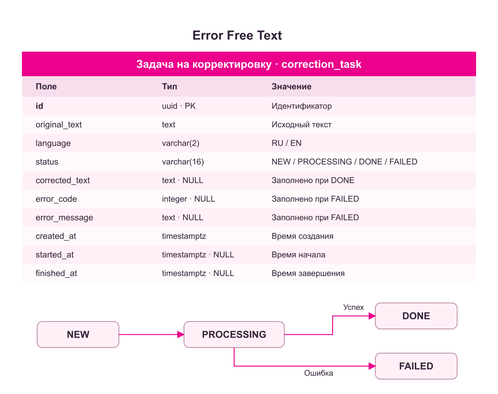
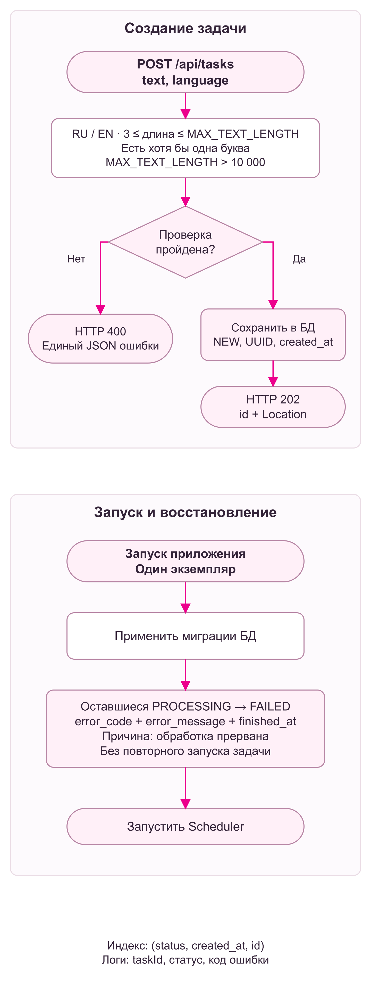
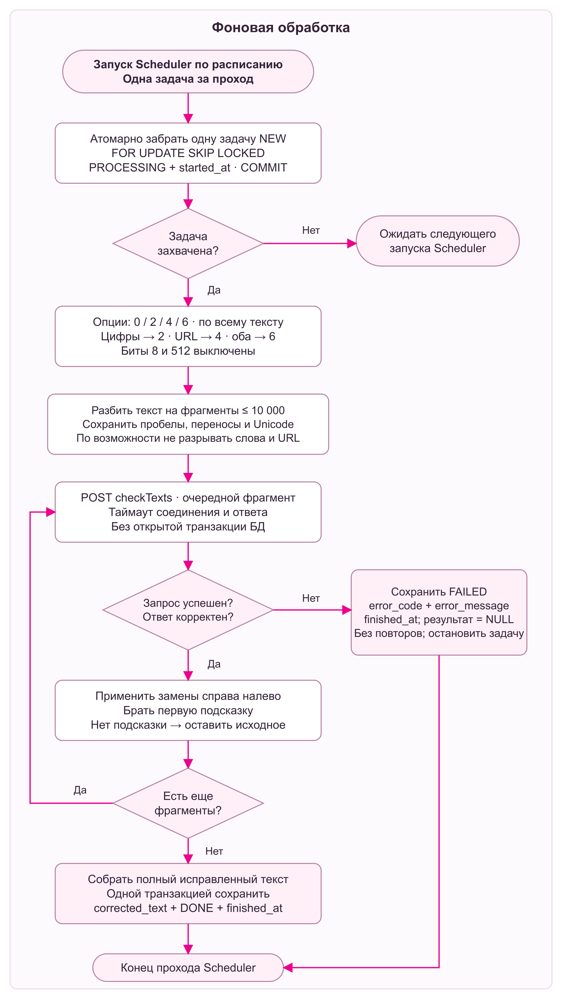
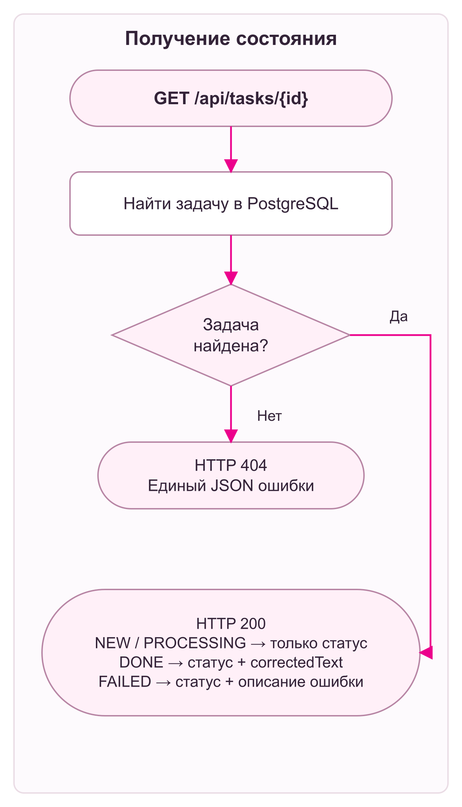

<h1 align="center">
  
</h1>

<h3 align="center">
  Асинхронный сервис орфографической коррекции текста (RU / EN)<br>
  с персистентной очередью на базе PostgreSQL
</h3>

<p align="center">
  <b>Java 21 x Spring Boot 3.5 x PostgreSQL 16 x Flyway x Yandex Speller API x Docker</b>
</p>

<p align="center">
  <code>HTTP 202 Ingestion</code> → <code>RDBMS Queue (SKIP LOCKED)</code> → <code>UTF-16 Chunking</code> → <code>Reverse-Offset Patching</code>
</p>

---

**Error Free Text** — монолитный backend-сервис и веб-интерфейс для пакетной проверки орфографии длинных текстов через внешний провайдер (Яндекс Спеллер). Архитектура разделяет прием задачи (Ingestion) и фоновую обработку (Processing), позволяя вернуть ответ клиенту после сохранения задачи. Во время обращения к Спеллеру транзакция БД уже закрыта и соединение с PostgreSQL не удерживается.

<h2 align="center">
  
</h2>

### Параметры обработки и лимиты

| Параметр | Значение / Механика |
|---|---|
| **Длина поля `text`** | `3` code points min — `100 000` UTF-16 code units max (настраивается) |
| **Размер чанка (Batching)** | До `10 000` UTF-16 code units на 1 HTTP-запрос к внешнему API |
| **Таймауты внешнего I/O** | Соединение: `3 000 ms` · Запрос: `10 000 ms` (`SPELLER_TIMEOUT`) |
| **Интервал воркера** | `fixedDelay = 3 000 ms` после завершения предыдущего прохода; одна задача за проход |
| **Клиентский поллинг (UI)** | Интервал: `1 500 ms` · Hard-timeout ожидания на клиенте: `10 min` |
| **Повторная обработка** | Автоматических повторов задачи нет; при ошибке фрагмента обработка прекращается |
| **Применение исправлений** | От конца фрагмента к началу, чтобы замены не сдвигали позиции оставшихся слов |

<h2 align="center">
  
</h2>

Система реализована без внешнего брокера сообщений (очередь задач в PostgreSQL). В едином JVM-процессе работают REST-контур, статика UI и планировщик с последовательной обработкой задач.

### Матрица ответственности компонентов

| Компонент | Зона ответственности |
|---|---|
| `TaskController` / `ApiExceptionHandler` | Входной REST-контур, DTO-валидация, маппинг исключений в единый JSON-контракт |
| `TaskService` | Управление транзакционными границами (`@Transactional`), переходы состояний FSM |
| `TaskRepository` | Запросы к PostgreSQL, захват задач через `FOR UPDATE SKIP LOCKED` |
| `CorrectionTaskScheduler` | Recovery зависших задач при старте контекста, триггер воркера по `fixedDelay` |
| `TaskProcessor` | Оркестрация пайплайна: чанкинг → сетевой I/O → патчинг → сохранение |
| `TextOptions` | Статический анализ текста ($O(L)$) для вычисления битовой маски Спеллера |
| `TextChunker` | Декомпозиция строки по пробельным границам с защитой суррогатных пар UTF-16 |
| `SpellerClient` | Низкоуровневый HTTP-клиент (`java.net.http.HttpClient`), сериализация `x-www-form-urlencoded` |
| `CorrectionApplier` | Применение диффов справа налево (Reverse-Offset Patching), валидация границ |

### Модель данных и инварианты БД



Таблица `correction_task` (управляется через Flyway `V1__create_correction_task.sql`, верифицируется Hibernate `ddl-auto: validate`). Чанки не персистятся и живут только в heap во время работы `TaskProcessor`.

* **Индекс очереди:** `idx_task_queue ON (status, created_at, id)` помогает выбирать задачи `NEW` по времени создания и UUID.
* **Консистентность на уровне СУБД:** `CHECK`-ограничения связывают статус с заполнением результата, ошибки и временных меток.

| Статус | Временные метки | Результат и ошибка |
|---|---|---|
| `NEW` | Только `created_at` | Результат и ошибка отсутствуют |
| `PROCESSING` | Добавлен `started_at` | Результат и ошибка отсутствуют |
| `DONE` | Добавлен `finished_at` | Есть `corrected_text`, ошибки нет |
| `FAILED` | Добавлен `finished_at` | Есть код и сообщение ошибки, результата нет |

<h2 align="center">
  
</h2>

### 1. Ingestion & Двойная семантика длины Unicode

При `POST /api/tasks` выполняется двухуровневая проверка длины строки:

1. **Нижняя граница ($\ge 3$ символов и $\ge 1$ буквы):** считается через `String.codePointCount()`. Суррогатная пара (например, эмодзи за пределами BMP) учитывается как **1** символ.
2. **Верхняя граница ($\le 100\,000$):** считается через `String.length()` в единицах UTF-16: суррогатная пара занимает **2** единицы. В тех же единицах приложение ограничивает размер фрагмента.

Поле `language` принимает только `RU` или `EN` в верхнем регистре. Пустой текст, отсутствие обязательных полей и неверный JSON приводят к HTTP `400`.

Задача сохраняется в БД со статусом `NEW` до возврата `202 Accepted`. Ответ содержит UUID и заголовок `Location: /api/tasks/{id}`. Статус `202` подтверждает приём задачи, но не успешное исправление текста.



### 2. Захват задачи и изоляция соединений (Locking Strategy)

Воркер забирает задачу в короткой транзакции:

```sql
SELECT * FROM correction_task
WHERE status = 'NEW'
ORDER BY created_at, id
LIMIT 1
FOR UPDATE SKIP LOCKED;
```

В той же транзакции задача получает `PROCESSING` и `started_at`. После фиксации транзакции блокировка снимается; запросы к Спеллеру идут отдельно от работы с БД. Если подходящей записи нет, проход заканчивается.

`SKIP LOCKED` пропускает занятые записи, но само по себе не делает приложение готовым к запуску нескольких экземпляров: восстановление после старта рассчитано на один процесс.

### 3. Подготовка текста и опций

Маска `options` вычисляется один раз по всему исходному тексту и используется для каждого фрагмента:

| Содержимое текста | `options` |
|---|---:|
| Нет цифр и URL | `0` |
| Есть цифры | `2` — `IGNORE_DIGITS` |
| Есть URL | `4` — `IGNORE_URLS` |
| Есть и цифры, и URL | `6` |

Цифры определяются через `Character.isDigit`; URL — по префиксам `http://`, `https://`, `www.` без учёта регистра, до первого пробельного символа. Опции `FIND_REPEAT_WORDS = 8` и `IGNORE_CAPITALIZATION = 512` не включаются.

`TextChunker` делит строку на фрагменты до 10 000 единиц UTF-16, по возможности по пробелу или переносу строки. Разделители сохраняются, суррогатные пары не разрываются. Фрагменты из одних пробелов не отправляются во внешний сервис.

URL длиннее лимита сохраняется целиком без проверки. Слишком длинное слово приходится разделять по безопасной границе Unicode — качество проверки на такой границе может снижаться.

### 4. Запросы к Спеллеру и исправления

Фрагменты проверяются последовательно через `POST checkTexts`, с телом `application/x-www-form-urlencoded` в UTF-8. Передаются `text`, `lang` (`ru` / `en`), `options` и `format=plain`.

Ответ проверяется до применения исправлений: структура JSON, типы полей, границы и отсутствие пересечений диапазонов, совпадение исходного слова. Для замены берётся **первая подсказка**; пробелы по её краям удаляются. Если подсказок нет или первая пустая, слово остаётся исходным.

Замены выполняются справа налево. Это сохраняет исходные позиции ещё не обработанных слов:

```text
Helo wrld! → Helo world! → Hello world!
```

### 5. Завершение задачи

После проверки всех фрагментов результат собирается в исходном порядке. Отдельная транзакция сохраняет `corrected_text`, `DONE` и `finished_at`.

При первой ошибке запроса или ответа обработка останавливается: следующие фрагменты не отправляются, частичный результат не сохраняется. В БД записываются `FAILED`, код, сообщение ошибки и время завершения. Автоматических повторов нет.

Если недоступна сама БД, сохранить новый статус до восстановления соединения невозможно. Если задача останется в `PROCESSING`, её обработает механизм восстановления при следующем запуске приложения.



### 6. Получение состояния

`GET /api/tasks/{id}` только читает запись из PostgreSQL: повторной проверки текста не запускает. Веб-интерфейс опрашивает API примерно раз в 1,5 секунды, до `DONE` или `FAILED`, и ограничивает ожидание десятью минутами. Окончание ожидания в браузере не отменяет серверную задачу.



### 7. Восстановление после перезапуска

Миграции Flyway выполняются при старте. Перед включением планировщика оставшиеся задачи `PROCESSING` переводятся в `FAILED` с кодом `50002` и сообщением о прерывании обработки. Их выполнение не повторяется.

Задачи `NEW` остаются в очереди; `DONE` и `FAILED` сохраняются. Это работает при сохранении данных PostgreSQL. В Docker Compose используется отдельный volume `postgres_data`.

**Приложение рассчитано на один экземпляр.** Для нескольких экземпляров понадобится учитывать владельца задачи и отличать завершившийся процесс от ещё работающего.

<h2 align="center">
  
</h2>

### Создать задачу

```http
POST /api/tasks
Content-Type: application/json

{"text":"Превет, мир!","language":"RU"}
```

```http
HTTP/1.1 202 Accepted
Location: /api/tasks/c0f5ed12-7304-4fb5-b3bc-0c28cb04d184
Content-Type: application/json

{"id":"c0f5ed12-7304-4fb5-b3bc-0c28cb04d184"}
```

### Получить состояние или результат

```http
GET /api/tasks/c0f5ed12-7304-4fb5-b3bc-0c28cb04d184
```

Для существующей задачи всегда возвращается HTTP `200`. Поля со значением `null` в JSON не включаются:

| Состояние | Пример тела ответа |
|---|---|
| В очереди | `{"status":"NEW"}` |
| Обрабатывается | `{"status":"PROCESSING"}` |
| Выполнена | `{"status":"DONE","correctedText":"Привет, мир!"}` |
| Ошибка обработки | `{"status":"FAILED","errorCode":50401,"errorMessage":"Сервис проверки не ответил вовремя"}` |

`FAILED` — результат фоновой обработки. Его нужно проверять в JSON, даже если GET вернул HTTP `200`.

### Ошибки API и обработки

Ошибка самого REST-запроса возвращается с соответствующим HTTP-статусом и единым телом:

```json
{
  "errorMessage": "Задача не найдена",
  "errorCode": 40401,
  "timestamp": "2026-10-20T09:00:00Z",
  "path": "/api/tasks/c0f5ed12-7304-4fb5-b3bc-0c28cb04d184"
}
```

| HTTP | `errorCode` | Причина |
|---|---:|---|
| `400` | `40001` | Неверный текст, язык, UUID или JSON |
| `404` | `40401` | Задача или ресурс не найдены |
| `405` | `40501` | Неподдерживаемый метод |
| `415` | `41501` | Неподходящий Content-Type |
| `500` | `50001` | Внутренняя ошибка |

Коды внутри задачи `FAILED`:

| `errorCode` | Причина |
|---:|---|
| `50201` | Ошибка связи со Спеллером или ответ с HTTP-статусом, отличным от `200` |
| `50202` | Некорректный ответ или позиции исправлений |
| `50401` | Тайм-аут запроса к Спеллеру |
| `50002` | Обработка прервана |
| `50001` | Непредвиденная ошибка обработки |

<h2 align="center">
  
</h2>

### Запуск через Docker Compose

Нужны Docker и Docker Compose. Отдельная установка Java для этого способа не требуется.
Из корня репозитория скопировать пример настроек:

```bash
cp .env.example .env
```

В PowerShell:

```powershell
Copy-Item .env.example .env
```

В `.env` указать своё значение `POSTGRES_PASSWORD`. Затем:

```bash
docker compose up -d --build
```

Веб-интерфейс: **http://localhost:8090**

```bash
docker compose ps
curl http://localhost:8090/actuator/health
```

Ожидаемый ответ проверки состояния:

```json
{"status":"UP"}
```

Остановка с сохранением данных:

```bash
docker compose down
```

PostgreSQL хранит данные в отдельном Docker volume.
В Compose база не публикует свой порт на хост, а порт приложения привязан к `127.0.0.1`.
Для доступа извне отдельно настраивается reverse proxy.

### Локальный запуск приложения

Нужны JDK 21 и доступный PostgreSQL.
Создать базу `error_free_text` и пользователя с правами на её схему.
Указать переменные окружения `DB_URL`, `DB_USER`, `DB_PASSWORD`.

```bash
./gradlew bootRun
```

В PowerShell:

```powershell
.\gradlew.bat bootRun
```

При таком запуске приложение доступно на **http://localhost:8080**.
Миграции выполняются автоматически при старте.

### Сборка JAR

```bash
./gradlew bootJar
```

Результат:

```text
build/libs/error-free-text.jar
```

Запуск собранного приложения с настроенными переменными доступа к базе:

```bash
java -jar build/libs/error-free-text.jar
```

Основной `Dockerfile` собирает приложение из исходников.
`Dockerfile.runtime` используется для упаковки уже собранного JAR:
для него файл `error-free-text.jar` должен находиться в корне контекста сборки.

<br>

<h2 align="center">
  
</h2>

| Переменная | Значение по умолчанию | Назначение |
|---|---|---|
| `DB_URL` | `jdbc:postgresql://localhost:5432/error_free_text` | Подключение к базе |
| `DB_USER` | `error_free_text` | Пользователь PostgreSQL |
| `DB_PASSWORD` | Не задан | Пароль для локального запуска приложения |
| `MAX_TEXT_LENGTH` | `100000` | Максимальная длина исходного текста в единицах UTF-16 |
| `SCHEDULER_DELAY` | `3000` | Пауза после завершения прохода планировщика, мс |
| `SPELLER_TIMEOUT` | `10s` | Тайм-аут одного запроса к Спеллеру |
| `SPELLER_URL` | Адрес `checkTexts` Яндекс Спеллера | URL внешнего сервиса |
| `POSTGRES_PASSWORD` | Обязателен в Compose | Пароль базы и подключения приложения в контейнере |
| `APP_PORT` | `8090` | Порт на хосте при запуске через Compose |
| `APP_DOCKERFILE` | `Dockerfile` | Файл сборки образа приложения |

Параметры приложения берутся из его окружения.
Если нужно изменить, например, `MAX_TEXT_LENGTH` при запуске через Compose,
эту переменную нужно также передать в `services.app.environment`.
Одного добавления произвольной переменной в `.env` для передачи её внутрь контейнера недостаточно.

### Логирование

Логи выводятся в консоль. Отдельный файл логов в приложении не настроен.

```bash
docker compose logs -f app
```

В журнале отмечаются начало и завершение обработки, UUID задачи,
длина исходного текста, коды ошибок и количество прерванных задач при запуске.
При ошибке API записываются тип исключения и путь запроса.

<br>

<h2 align="center">
  
</h2>

```bash
./gradlew test
```

В PowerShell:

```powershell
.\gradlew.bat test
```

Проверяются:

- валидация текста и языка, отсутствие задачи и переходы статусов;
- вычисление опций `0`, `2`, `4`, `6`;
- разбиение длинного текста, сохранение пробелов и суррогатных пар;
- сохранение слишком длинного URL без отправки его частей на проверку;
- применение исправлений справа налево и отклонение некорректных позиций;
- остановка после ошибки фрагмента без повторной отправки;
- формат запросов к Спеллеру и обработка неверных ответов;
- HTTP-ответы контроллера и совместный запуск планировщика с автоконфигурацией Spring.

HTTP-клиент тестируется с локальным тестовым HTTP-сервером.
Автоматические тесты не обращаются к настоящему Яндекс Спеллеру и не требуют запущенного PostgreSQL. Для них нужен JDK 21; Gradle Wrapper загрузит Gradle и зависимости при первом запуске.

HTML-отчёт:

```text
build/reports/tests/test/index.html
```

<br>

<h2 align="center">
  
</h2>

- Обработка последовательная: одна задача за проход планировщика.
- Для восстановления после перезапуска используется один экземпляр приложения.
- Авторизации нет: результат доступен по UUID задачи.
- Повторный POST создаёт новую задачу: ключ идемпотентности и устранение дубликатов не реализованы.
- Исходные тексты и результаты сохраняются без автоматического удаления по сроку.
- Итоговый вариант зависит от подсказок Спеллера; это проверка орфографии, а не стилистическая редактура текста.
- Проверки настоящего PostgreSQL и полного сценария запуска пока не выделены в автоматические интеграционные тесты.

Дальше можно добавить срок хранения задач, ограничение длины очереди,
авторизацию, интеграционные тесты с PostgreSQL и метрики времени обработки.

